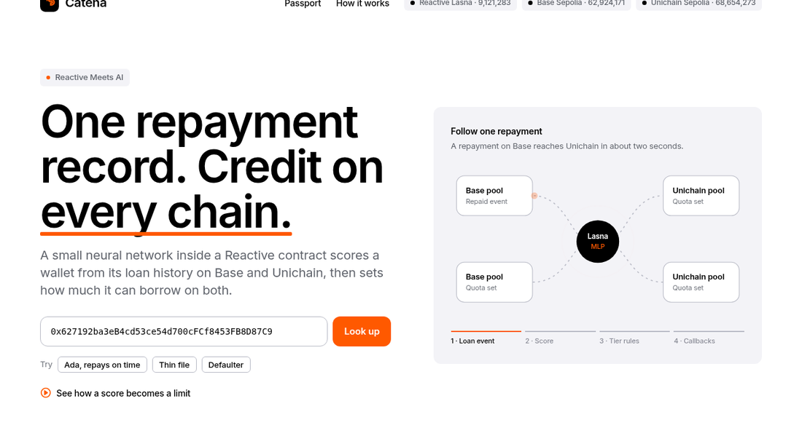
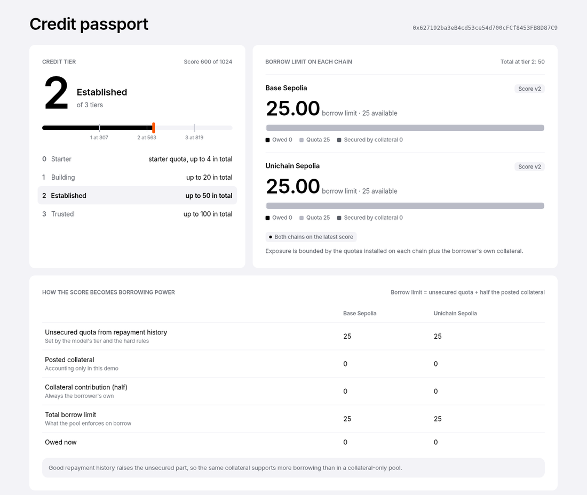
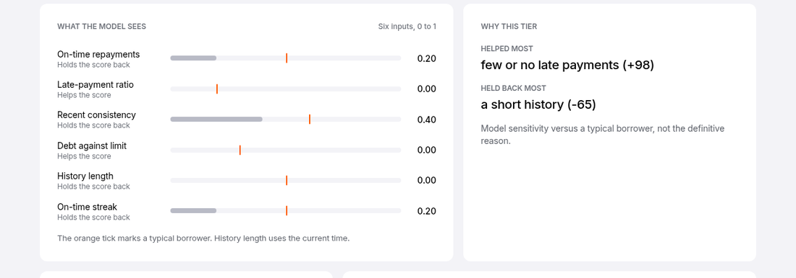
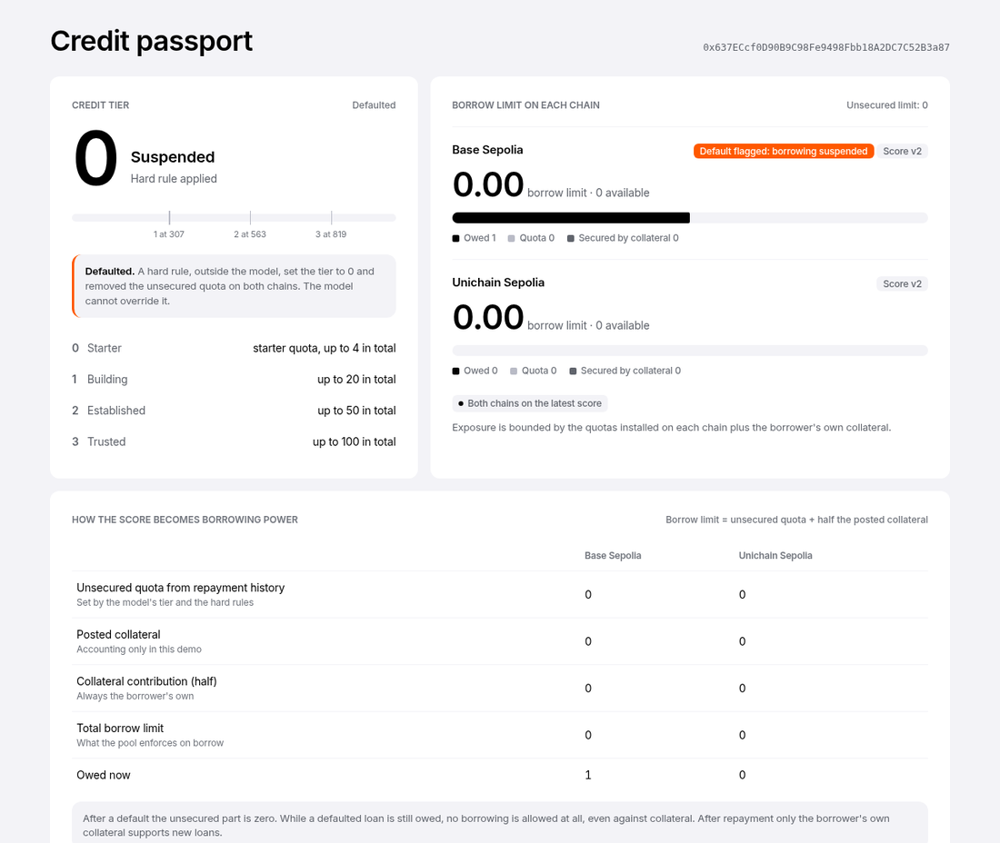
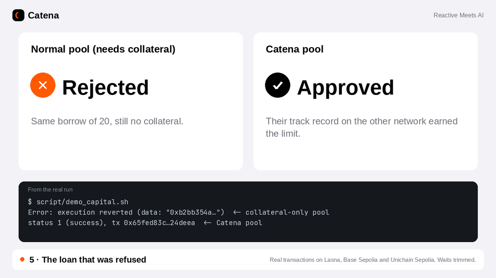
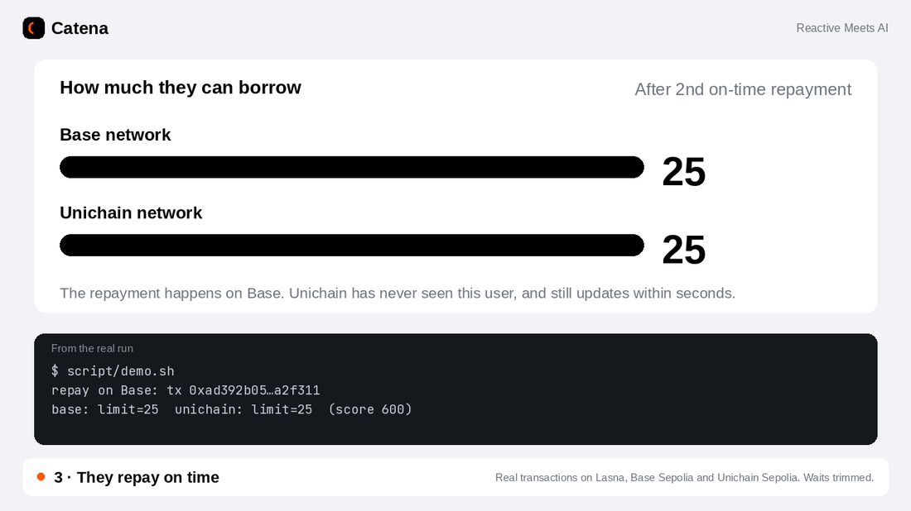

# Catena

**A credit history that follows you across blockchains.** Built for the Reactive Omni Buildathon (Reactive Meets AI track).
Test networks, fake money, not production credit scoring.



## In plain English
**The problem.** Crypto lending usually asks you to lock up more than you borrow. And even if you have repaid every loan on
time on one blockchain, a lender on another blockchain knows nothing about you.

**What Catena does.** It keeps one repayment record per wallet across blockchains, scores it with a small neural network, and
uses the score to decide how much that wallet may borrow on *each* chain. Repay on time on one chain and your borrowing limit
rises on both within a couple of seconds. Miss a payment and the limit drops to zero on both. Because it runs on **Reactive
Network**, which lets one smart program watch events on one blockchain and act on another, there is no off-chain server
deciding anything: the model itself runs inside the on-chain transaction.

**A walk-through.**
1. A brand new wallet asks for 20 units. A normal pool that wants collateral says no. Our pool also says no, but only because
   the wallet is new: it gets a small starter amount (2).
2. The wallet borrows a little and repays on time on the first chain. The second chain has never seen this wallet.
3. Within seconds the limit on **both** chains rises, first to 10 and then to 25 (one level at a time, by design).
4. The same 20-unit borrow that was refused now goes through, with no collateral, because of the repayment history.
5. Collateral still helps: with the same collateral in both pools, good history allows far more borrowing.
6. If the wallet defaults, its limit drops to zero on both chains. That rule sits outside the model, so the model cannot
   override it. The chain that saw the default reacts at once, the other follows in about 1 to 3 seconds (we do not claim it is instant).
7. Even if someone tries to borrow the maximum on both chains at the same moment, total borrowing stays within the limit.

**What we claim, and what we do not.** It works end to end on testnets, it is transparent and reproducible, and the score is
computed on-chain. The model learned from made-up data and is only about as accurate as a simple formula (66.7% against
65.9%), so we do not claim it is smarter, only that it is auditable and runs entirely on-chain.

A 2:14 demo video, assembled from a real run, is built with the scripts in `video/`.

## Screenshots
Real pages read live from the chains (the dashboard is `web/index.html`).

**One wallet's passport: trust level, borrowing limit on each chain, and how the score becomes borrowing power.**


**What the model looked at, and the main reasons for the result.**


**After a default: a hard rule removes the unsecured limit on both chains, and no borrowing is allowed until the defaulted loan is repaid.**


**From the demo video: the same borrow is refused by a normal pool and approved by the Catena pool, and the limit follows the user to the second chain.**



## How it works
1. Pools on each chain emit `Borrowed`, `Repaid(late?)` and `Defaulted` events.
2. `CatenaReactive` keeps one passport per wallet (six features), dedups events, and runs the MLP in fixed-point integer math.
3. The score gives a tier, and the tier sets a total limit that is split into fixed per-chain quotas, pushed by callback.
4. Hard rules sit outside the model: a default forces zero, cuts apply at once, raises climb one tier per period,
   new wallets start at tier 0 with a small starter quota, and stale or replayed updates are ignored.
5. When a tier changes the contract records the biggest helping and hurting inputs (model sensitivity, not the definitive cause).

What the security design guarantees, and what it does not:

| Guarantee | Holds? |
|---|---|
| Concurrent draws on several chains cannot exceed the sum of the quotas currently installed (`script/security_test.sh`) | Yes, whatever the callback latency |
| An older callback cannot overwrite a newer assessment (score version check in the pool) | Yes (`test_poolIgnoresStaleVersion`) |
| A default flagged on a pool removes that pool's unsecured limit immediately, and blocks all borrowing there while the defaulted loan is still owed | Yes (`defaultFlagged`, no callback needed) |
| A default on one chain blocks borrowing on the other chain immediately | **No.** The other pool keeps its old quota until the zero-quota callback arrives, a window of about 1 to 3 seconds measured on testnet. Exposure in that window is bounded by the old quota minus debt (`test_defaultBlocksLocallyAtOnceAndRemotelyAfterCallback`) |

Quotas bound concurrent borrowing against the allocations installed at that moment. They do not make cross-chain
revocation instantaneous. Removing the window would need a short-lived authorization the pool checks before each draw,
which this prototype leaves out.

## Hybrid lending (not all-or-nothing)
A pool's borrow limit is `unsecured quota from history + half of the posted collateral` (`borrowLimit`). Good history
raises the unsecured part, so less collateral is needed. A default removes the unsecured part at once on the pool that
sees it, and on the other chain when the callback lands. While a flagged borrower still owes the defaulted loan they cannot
borrow at all, even against their own collateral. After they repay, only the secured part (half the collateral) comes back;
the unsecured part stays at zero. The dashboard shows both parts per chain. The collateral-only pool is the same contract with the unsecured part switched off.
This demonstrates permissioning from a cross-chain repayment record. It does not show that unsecured lending is
economically safe: collateral here is accounting only (no withdrawal, no liquidation), and a real lender would keep its
own risk and liquidity controls.

## Why a neural network at all?
We do not claim it predicts credit risk better than a simple formula: on synthetic data it is about level with a fitted
linear formula and a transparent scorecard approves fewer risky borrowers (`model/evaluation.md`). What it demonstrates is
**deterministic, auditable AI inference inside a reactive contract that drives cross-chain permissions**: trained and quantized
reproducibly, bit-exact against its Python spec, monotone by construction (so a repayment can never lower a score), and cheap
enough (about 37k gas per forward pass) to run on every event.

## How it fails (and what is tested)
| Failure | What happens | Evidence |
|---|---|---|
| The reactive contract runs out of lREACT | The network silently stops delivering its events, so scores and quotas stop updating and the last installed quotas stay in force. This happened during testing. Anyone can restore it with `depositTo`, and `script/check_funds.sh` (also a guard in every demo script) catches it first. | `Funds.t.sol` (`coverDebt` needs funds, then clears) |
| A pool cannot pay for its callbacks | A callback that cannot be paid does not arrive, so the old quota stays. Cuts are the risky case, so a default flagged on the pool itself blocks borrowing without any callback. Anyone can fund the pool and call `coverDebt()`. | `Funds.t.sol` (empty pool still blocks a defaulter; funded pool revives) |
| A callback arrives late | The pool keeps its old quota until it lands (1 to 3 s measured). Exposure in that window is bounded by the old quota minus debt. | `test_defaultBlocksLocallyAtOnceAndRemotelyAfterCallback` |
| An older callback arrives after a newer one | Ignored: the pool only accepts a higher score version. | `test_poolIgnoresStaleVersion` |
| The same event is processed twice | Ignored: events are deduplicated by chain, transaction hash and log index. | `test_duplicateEventIgnored` |
| A defaulter borrows again against collateral | Blocked while the defaulted loan is still owed. | `test_defaultRemovesUnsecuredPartAndBlocksBorrowingUntilRepaid` |

## Layout
| Path | What |
|---|---|
| `src/CatenaPool.sol` | demo pool + callback receiver, same code on every chain; `collateralOnly` mode is the demo's "before" case |
| `src/CatenaReactive.sol` | passport state, features, rules, reasons, callbacks |
| `src/Mlp.sol` | GENERATED integer MLP (6 -> 8 ReLU -> 1), monotone by construction |
| `model/train.py` | synthetic data, constrained training, quantization, export, evaluation |
| `model/replay.py` | Python spec of the contract's state machine, used for whole-history parity tests |
| `model/model_card.md` | data rules, metrics, baselines, limits (read this before trusting any number) |
| `model/evaluation3.md` to `evaluation7.md` | where the model fails, a thin-file cap test, pre-redeploy checks, and a recent-window feature experiment (`model/evaluate3.py` to `evaluate7.py`; all Python only, synthetic data) |
| `model/evaluation2.md` | harder test: changing borrower types, real default process, temporal split, thin files (`model/evaluate2.py`) |
| `model/evaluation.md` | extra checks: risky-borrower approvals, leave-one-population-out, transparent scorecard baseline (`model/evaluate.py`) |
| `test/` | contract tests, Python-vs-Solidity parity (vectors and 842-event histories), monotone fuzz, overflow, exhausted callback funds (`Funds.t.sol`), delayed revocation |
| `script/` | `deploy.sh`, `demo.sh`, `demo_wallets.sh`, `demo_capital.sh`, `security_test.sh`, `latency.sh`, `trace_loop.sh` (one full loop with every tx hash), `check_funds.sh`, `new_actor.sh`, `gen_web_config.sh` |
| `web/` | static page, no backend: look up any wallet and see its tier, the six inputs the model saw, the borrow limit on each chain (owed, quota, secured by collateral), reasons and scorings, read live from the RPCs every 4 s, with live network status. `script/gen_web_config.sh`, then `cd web && python3 -m http.server`, open `?w=<address>` |
| `docs/DEMO_SCRIPT.md` | shot-by-shot script for the under-3-minute video, with the pre-filming checklist |
| `docs/REPRODUCING_DEPLOYMENTS.md` | toolchain, constructor arguments, code hashes, how to account for immutables, and what was tried for verification |
| `docs/img/` | screenshots used in this README |
| `video/` | scripts that build the demo video from a real run (capture, narration, render) |
| `docs/SUBMISSION.md` | addresses, a full-loop transaction table, what to look at, honest limits |
| `LICENSE` | MIT |

## Run
```
forge install foundry-rs/forge-std   # test library (reactive-lib-omni is a submodule: git submodule update --init)
forge test                        # 28 tests
python3 -m venv .venv && .venv/bin/pip install numpy
.venv/bin/python model/train.py && .venv/bin/python model/replay.py   # regenerate model + test vectors
cp .env.example .env              # PRIVATE_KEY (throwaway testnet key), RPCs
script/deploy.sh                  # reactive first, then pools (callback sender is immutable)
script/check_funds.sh             # reactive contract needs lREACT, each pool needs native gas
script/demo.sh && script/demo_capital.sh && script/demo_wallets.sh && script/security_test.sh
script/trace_loop.sh              # one full loop with every transaction hash, as markdown
```
Funding matters: each reactive transaction costs about 0.03 lREACT at 100 gwei and every pool event triggers one.
A contract in debt silently stops receiving events. lREACT comes from the faucet contracts in the Reactive docs.

## Deployed (testnets, filming timers: raise period 15 s, loan 40 s, grace 15 s)
| Contract | Chain | Address |
|---|---|---|
| CatenaReactive | Reactive Lasna (5318007) | `0xc79198B4DBaB0d3C1D0454B737719b85cbC12475` |
| CatenaPool | Base Sepolia (84532) | `0x565d1B97E21d6D80bC5D4Eefe292EC199c0Ca469` |
| CatenaPool | Unichain Sepolia (1301) | `0xf715898abABFc48fD4D359cf68F5EBe56AC10D9D` |
| CatenaPool (collateral-only, demo "before") | Unichain Sepolia | `0x088F83Fd4Bc089Cb7D7845c1b32611aeB97eFd25` |

Earlier deployments are archived in `deployments.v*.env`. The timers are constructor parameters (`script/deploy.sh`
defaults are 60 s / 60 s / 30 s).

## Measured (Lasna, Base Sepolia, Unichain Sepolia)
- `react()` for a repay including two callbacks: 185k to 202k gas (cap 900k). One MLP forward pass: about 37k gas.
- Origin event to destination callback (`script/latency.sh`, 4 rounds, block timestamps with 1 s resolution):
  event on Base to quota update on Base 0 to 2 s (mean 1.0 s); to the quota update on Unichain 1 to 3 s (mean 2.0 s, cross-chain clocks can differ by about 1 s).
- Model, held-out synthetic data: MLP 66.7% tier accuracy vs 65.9% for a fitted linear formula, so the
  win over a plain formula is small. See `model/model_card.md`.
- Further checks (`model/evaluation.md`): among borrowers truly below the tier-1 bar, a transparent scorecard wrongly approves
  20.0%, the MLP 24.5%, the fitted linear formula 29.1%. Tested on a borrower population left out of training, the MLP is slightly
  better on two populations and clearly worse than the scorecard on the unreliable one. A much larger unconstrained network
  reaches only 68.4% and ten times more training data changes nothing, so the ceiling is how much a short repayment history can
  reveal. We claim a working, monotone, auditable on-chain model, not a large accuracy win. Monotonicity is a safety property, not accuracy.
- Harder test (`model/evaluation2.md`): loans from borrowers whose behaviour changes (deteriorating, recovering, strategic defaulters), a real default process and a temporal split. The deployed network, trained on the simpler generator, approves 22.4% of truly risky loans at a 40% approval rate. The same architecture retrained on that data approves 14.2%, level with a fitted linear formula (14.1%). Cost-sensitive weights and a confidence shrink did not help. Every scorer approves too many borrowers who are about to deteriorate or default, which is why the hard rules sit outside the model. The deployed weights are not retrained yet. A follow-up (`model/evaluation3.md`) shows why: the deployed network scores deteriorating borrowers worse than chance on this data, but the retrained one gives wallets with no history a top score, so it needs a thin-file policy cap before it could replace the deployed model. Strategic defaulters cannot be caught before their first missed payment by any history-based score. We also evaluated an eight-input candidate that adds a recent late ratio and a recent-trend input, because a borrower who struggled early and has since become reliable should not stay penalised forever (`model/evaluation6.md`). In the simulation it recovers most of the lost approvals for recovering borrowers (3.5% to 20.1%, against 26.7% for the deployed model) while keeping most of the gain on deteriorating borrowers. **Catena does not use it.** The deployed contracts run the six-input model; we kept it to avoid unverified production changes shortly before submission. At matched approval rates (`model/evaluation7.md`) it approves about as many low-risk recovering loans as the deployed model (24.7% against 25.3% at a 40% target) and far fewer risky ones (15.1% against 27.6%). Every figure comes from synthetic data.

## Chain facts (Reactive docs)
Lasna chain ID 5318007, system contract `0x8888…8888`. Callback proxies: Base Sepolia `0x476F…0585`,
Unichain Sepolia `0x775c…66C1`.

## Reproducing the deployed contracts
Compiler `solc 0.8.30`, EVM `cancun`, optimizer on with 200 runs (`foundry.toml`). Constructor arguments: `CatenaReactive(15)`;
`CatenaPool(callbackProxy, reactive, collateralOnly, 40, 15)` with the proxies listed under Chain facts, the reactive address above,
and `collateralOnly = true` for the "before" pool. On-chain runtime code hashes (`cast codehash`):

| Contract | Code hash |
|---|---|
| CatenaReactive (Lasna) | `0xd1f91338d147aecff7e173a890a064825537a7e92e7944c65205160aff5ed68b` |
| CatenaPool (Base Sepolia) | `0x66625c7f5393ac3b4553c5a2e1326321573a7d553e8cfaea9caaa798ce38bbc5` |
| CatenaPool (Unichain Sepolia) | `0x8993ca04bdcc10880c85b2a67732d3d7efeef40250ca4cdce7b9599023fbc9ae` |

The pools differ by hash because immutables (proxy address, reactive sender, timers) are embedded in the runtime code, so a local
build matches only after masking them. This is evidence for a reviewer, not verification. Full steps are in
`docs/REPRODUCING_DEPLOYMENTS.md`.

## Limits
Synthetic training data; address-based identity (a defaulter can open a new wallet, which starts at tier 0);
one scripted demo, not a product.

**Source verification is not done.** The Reactive docs point to Sourcify, but Sourcify's compile worker fails with
"Failed fetching solc" for 0.8.29 and 0.8.30 (the Omni library requires `^0.8.29`), and Reactscan has no verification
API. Reproduce locally: `forge build --build-info`, then POST the standard JSON input to
`https://sourcify.dev/server/v2/verify/5318007/<address>`. The source is public in this repo and the build is deterministic
(solc 0.8.30, optimizer 200 runs, cancun).

## Disclosure
Developed with AI assistance (Claude Code). Licensed under MIT (`LICENSE`).
